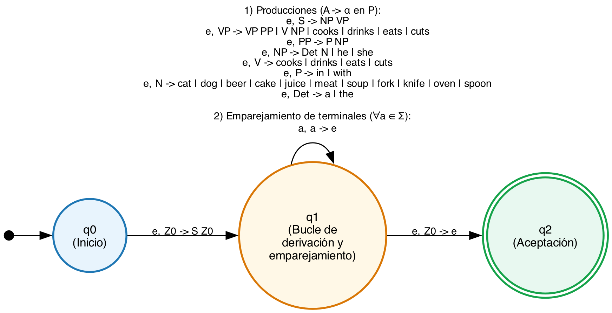
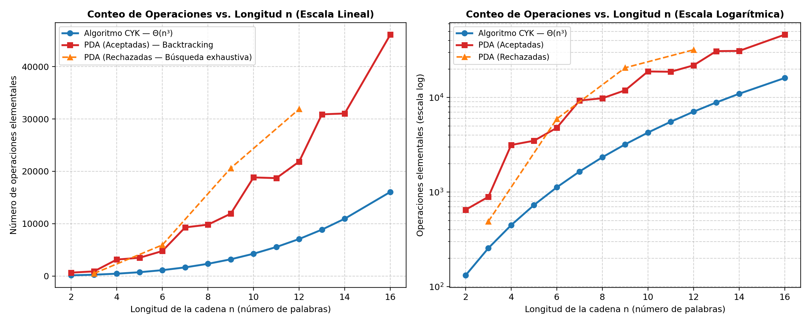

Samuel Mejía - 23442  
Teoría de la Computación, CC2019 - Sección 30  
Docente: Tomás Gálvez P. Semestre 2, 2026  
Repositorio: https://github.com/SamMejia23442/proyecto2_teoriacompu  

# **Proyecto #2: Reconocimiento de cadenas mediante autómatas de pila y algoritmo CYK**

Reconocimiento de cadenas pertenecientes a una gramática libre de contexto en forma normal de Chomsky mediante dos métodos: autómata de pila (PDA) obtenido por conversión directa de la gramática y el algoritmo CYK (Cocke-Younger-Kasami) mediante programación dinámica.

🎥 [Enlace a Video de Demostración del Proyecto](https://youtu.be/ln45IwjVS04)  
📄 [Documentación completa del proyecto en PDF](./documentación%20proyecto%202%20teoría%20compu.pdf)  
---

## 1. Definición del autómata de pila, PDA a partir de la gramática G

### 1.1. Gramática libre de contexto G = (V, Σ, S, P)

La gramática libre de contexto dada se encuentra en forma normal de Chomsky, CNF, dado que todas sus reglas son binarias de la forma A -> B C (con B, C en V) o terminales de la forma A -> a (con a en Σ):

* Variables (V, |V|=8): V = {S, VP, PP, NP, V, P, N, Det}
* Terminales (Σ, |Σ|=21): Σ = {a, beer, cake, cat, cooks, cuts, dog, drinks, eats, fork, he, in, juice, knife, meat, oven, she, soup, spoon, the, with}
* Símbolo inicial: S
* Conjunto de producciones (P, |P|=30: |PB|=5 binarias y |PT|=25 terminales):
  * S -> NP VP
  * VP -> VP PP | V NP | cooks | drinks | eats | cuts
  * PP -> P NP
  * NP -> Det N | he | she
  * V -> cooks | drinks | eats | cuts
  * P -> in | with
  * N -> cat | dog | beer | cake | juice | meat | soup | fork | knife | oven | spoon
  * Det -> a | the

### 1.2. Definición formal del PDA equivalente M = (Q, Σ, Γ, δ, q0, Z0, F)

Aplicando el algoritmo constructivo de conversión de una GLC a un autómata de pila no determinista que simula derivaciones por la izquierda desde el tope de la pila, se obtiene la 7-tupla formal:  
M = (Q, Σ, Γ, δ, q0, Z0, F)

* Conjunto de estados (Q): Q = {q0, q1, q2}, donde q0 es el estado de inicio, q1 es el estado central de bucle y q2 es el estado de aceptación.
* Alfabeto de entrada (Σ): El conjunto de 21 palabras terminales de G.
* Alfabeto de la pila (Γ, |Γ|=30): Γ = V ∪ Σ ∪ {Z0}.
* Estado inicial: q0 en Q.
* Símbolo inicial de la pila: Z0 en Γ.
* Conjunto de estados de aceptación (F): F = {q2}.
* Función de transición δ (53 transiciones en total):
  * Inicialización (1 transición): δ(q0, ε, Z0) = {(q1, S Z0)}
  * Expansión de producciones (30 transiciones): cuando una variable A está en el tope de la pila, se extrae sin consumir entrada y se apila el cuerpo de la producción.
  * Emparejamiento de terminales (21 transiciones): para cada terminal a en Σ, si coincide con el tope de la pila y con la palabra de entrada actual, se consume la palabra y se desapila a.
  * Aceptación (1 transición): al restar únicamente Z0 en la pila tras consumir la entrada, δ(q1, ε, Z0) = {(q2, ε)}.



### 1.3. Extensión del autómata finito del proyecto #1 en código (models.py)

Para reutilizar y extender la definición de autómata finito del proyecto #1: la clase TransicionPDA hereda directamente de Transicion e incorpora simbolo_pop (símbolo a extraer del tope de la pila) y simbolos_push (secuencia de símbolos a apilar); la clase Estado añade agregar_transicion_pda(); y la clase PDA hereda de AFD integrando la clase Pila y el registro de objetos DescripcionInstantanea (q, w, γ).

---

## 2. Investigación y cálculo de tasas de crecimiento, CYK vs. PDA

La tasa de crecimiento de ambos algoritmos se determina en función del conteo de operaciones elementales ejecutadas para reconocer una frase compuesta por n palabras.

### 2.1. Cálculo analítico de la tasa de crecimiento del algoritmo CYK

Para una frase de n palabras en la gramática G (|PT|=25 terminales y |PB|=5 binarias):

* Fase 1 (diagonal principal, l = 1): 2n operaciones de control más 2 operaciones por cada una de las 25 reglas terminales: TFase1(n) = 52n operaciones.
* Fase 2 (llenado triangular por programación dinámica, l = 2 a n): evalúa las (n^3 - n)/6 particiones posibles, con 2 operaciones de control y 4 operaciones por cada una de las 5 producciones binarias: Tparticiones(n) = (11/3)(n^3 - n) operaciones.
* Ecuación cerrada exacta: sumando la inicialización, Fase 1 y Fase 2:  
  T_CYK(n) = (11/3)n^3 + n^2 + (148/3)n
* Tasa de crecimiento asintótica de CYK: dominada por el término cúbico:  
  T_CYK(n) en Θ(n^3 · |PB|) = O(n^3)

### 2.2. Análisis y cálculo de la tasa de crecimiento del PDA

* No determinismo e invariante CNF: el estado q1 posee múltiples transiciones ε para una misma variable. Debido a que G está en CNF sin reglas ε, toda derivación aplica exactamente n - 1 reglas binarias y n terminales. Por ello, la cota de pila |γ| <= n - i poda cualquier lazo infinito provocado por la regla recursiva izquierda VP -> VP PP.
* Tasa de crecimiento del PDA (caso general y peor caso): al simular el no determinismo mediante búsqueda con retroceso (backtracking), el número de derivaciones posibles crece de forma exponencial según un factor de ramificación b > 1:  
  T_PDA(n) en O(b^n) (peor caso exponencial). En el mejor caso sin retroceso: Ω(n).

### 2.3. Resumen comparativo de operaciones

| Longitud n | Estado | Ops CYK (Empírico) | Ops CYK (Teórico) | Ops PDA | Configs PDA | Razón PDA / CYK | Frase de prueba |
| :---: | :---: | ---: | ---: | ---: | ---: | ---: | :--- |
| 2 | ACEPTADA | 132 | 132 | 651 | 11 | 4.93x | she eats |
| 3 | ACEPTADA | 256 | 256 | 892 | 13 | 3.48x | the cat drinks |
| 4 | ACEPTADA | 448 | 448 | 3,150 | 46 | 7.03x | she eats a cake |
| 5 | ACEPTADA | 730 | 730 | 3,490 | 50 | 4.78x | the dog eats the meat |
| 6 | ACEPTADA | 1,124 | 1,124 | 4,780 | 69 | 4.25x | the cat drinks in the oven |
| 7 | ACEPTADA | 1,652 | 1,652 | 9,293 | 135 | 5.63x | she eats a cake with a fork |
| 8 | ACEPTADA | 2,336 | 2,336 | 9,813 | 142 | 4.20x | the cat eats the soup with a spoon |
| 10 | ACEPTADA | 4,260 | 4,260 | 18,840 | 275 | 4.42x | she cuts the meat with a knife in the oven |
| 12 | ACEPTADA | 7,072 | 7,072 | 21,850 | 318 | 3.09x | the cat drinks with a spoon in the oven with a fork |
| 16 | ACEPTADA | 16,064 | 16,064 | 46,106 | 674 | 2.87x | she eats the cake with a fork in the oven with a spoon in the oven |
| 6 | RECHAZADA | 1,124 | 1,124 | 5,939 | 88 | 5.28x | she drinks juice with a spoon |
| 9 | RECHAZADA | 3,198 | 3,198 | 20,615 | 304 | 6.45x | she cuts a cake with a knife in oven |



---

## 3. Discusión de diferencias de desempeño entre CYK y PDA

1. Programación dinámica tabulada vs. búsqueda con retroceso: el algoritmo CYK resuelve cada subproblema T[i, j] una sola vez y guarda en memoria qué variables generan cada subcadena. Por el contrario, el PDA carece de memoria entre ramas de exploración: cuando una opción no determinista falla, el autómata retrocede y vuelve a evaluar los mismos sintagmas desde cero. Por esta razón, el PDA requirió entre 2.84x y 7.03x más operaciones que CYK en todas las frases evaluadas.
2. Invarianza frente a la entrada vs. sensibilidad al caso de rechazo: el costo de CYK es completamente determinista e invariante para una longitud n dada, ejecutando exactamente la misma cantidad de operaciones para frases válidas o rechazadas de igual longitud. En cambio, en el PDA una frase rechazada obliga a agotar exhaustivamente todas las alternativas del espacio de búsqueda, incrementando notablemente el conteo de operaciones.
3. Manejo de la recursión por la izquierda y ambigüedad: la regla VP -> VP PP es recursiva por la izquierda y requiere podar por longitud de entrada restante en el PDA para evitar ciclos infinitos. Además, ante ambigüedad estructural, el PDA sufre una explosión exponencial O(b^n), mientras que CYK absorbe la ambigüedad en los mismos conjuntos de variables manteniendo su complejidad cúbica O(n^3).
4. Compromiso espacio-tiempo y precondiciones: CYK requiere memoria cuadrática O(n^2 · |V|) para la tabla triangular y exige que la gramática esté en forma CNF. El PDA utiliza memoria lineal O(n) en la pila por rama activa y es aplicable directamente a cualquier gramática libre de contexto.

---

## 4. Estructura de archivos del proyecto

* models.py: contiene las clases Transicion, TransicionPDA, Estado, AFN, AFD, Pila, DescripcionInstantanea y PDA.
* gramatica.py: define la clase GramaticaLibreContexto, carga las producciones de G y realiza la tokenización de oraciones.
* pda.py: contiene la conversión de la gramática a PDA (gramatica_a_pda) y la simulación no determinista con registro de descripciones instantáneas y derivación (simular_pda).
* cyk.py: implementa el algoritmo CYK, la matriz triangular, el registro del llenado de celdas, el árbol sintáctico y la derivación por la izquierda.
* analisis_crecimiento.py: realiza el estudio empírico del conteo de operaciones elementales para frases de longitud n = 2 a 16 y genera grafica_crecimiento.png.
* main.py: interfaz de usuario por consola y punto de entrada para ejecución interactiva o directa por argumentos.
* test_proyecto2.py: suite de pruebas unitarias automatizadas para validar frases válidas, errores sintácticos y correspondencia analítica de CYK.
* frases_prueba.txt: conjunto de oraciones de prueba para procesamiento por lotes.
* documentación proyecto 2 teoría compu.pdf: documento formal de entrega en formato PDF.

---

## 5. Instrucciones de ejecución

### Menú interactivo
```bash
python3 main.py
```

### Reconocimiento directo de una frase en consola
```bash
python3 main.py "she eats a cake with a fork"
```

### Ejecutar suite de pruebas unitarias automatizadas
```bash
python3 test_proyecto2.py
```

### Ejecutar análisis de crecimiento y generar gráficas
```bash
python3 analisis_crecimiento.py
```
